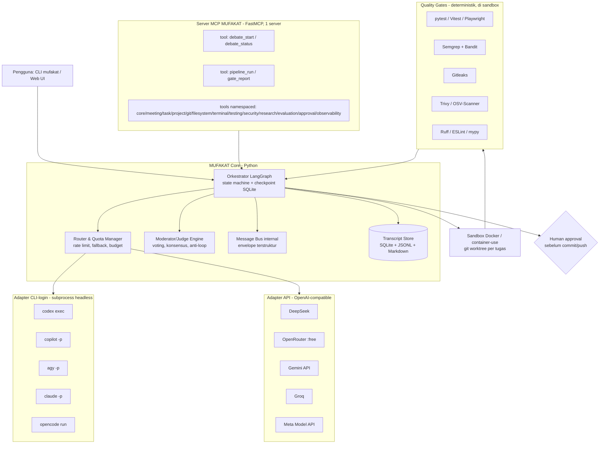

# BLUEPRINT MUFAKAT — Sistem Multi-AI Terpadu

> Gabungan dua sumber: (1) spesifikasi implementasi Claude — arsitektur MUFAKAT
> T1–T16 (debat → konsensus → coding → audit → test); (2) blueprint/riset ChatGPT —
> *Autonomous Multi-AI Engineering Organization* (master brief §0–§17).
> Bahasa kerja: Indonesia. Dokumen ini adalah blueprint; angka harga/kuota yang
> tidak punya sumber primer ditulis **belum terverifikasi** — jangan dikutip
> sebagai fakta.

---

## 1. Executive Assessment

**Apakah ide ini feasible? Ya, dengan jalur yang legal dan sempit.**
Satu ide masuk, banyak AI debat, saling kritik/koreksi, lalu menghasilkan
aplikasi — bisa dibangun sebagai **orkestrator pusat milik sendiri** (Python +
LangGraph) yang memanggil CLI coding agent resmi yang login dengan akun dan
API resmi. Yang **tidak** feasible/legal adalah mengotomasi web chat konsumen
(chatgpt.com, claude.ai, gemini.google.com, chat.deepseek.com, chat.qwen.ai,
meta.ai): melanggar ToS, rapuh terhadap perubahan UI/captcha, dan berisiko
akun di-banned. Jalur itu dikeluarkan dari desain MUFAKAT.

**Tantangan terbesar:**
1. **Kuota gratis sangat terbatas dan berubah cepat.** Debat menghabiskan
   banyak request; satu debat 3 agen × 3 ronde + moderator ≈ 10–13 panggilan.
   Qwen OAuth gratis dihentikan 15 Apr 2026, Gemini CLI pribadi dihentikan
   18 Jun 2026, Amp Free dihentikan sementara. Karena itu debat diarahkan ke
   API murah (DeepSeek, OpenRouter `:free`), kuota CLI dihemat untuk coding
   dan review.
2. **"Sepakat salah".** LLM bisa sepakat pada jawaban yang salah. Mitigasi:
   keragaman keluarga model, devil's advocate paksa, dan gerbang deterministik
   (test, Semgrep, Gitleaks) sebagai hakim akhir — bukan opini LLM.
3. **Kebijakan "wrapping" CLI.** FAQ Antigravity menyatakan wrapping `agy`
   di dalam aplikasi pihak ketiga tidak didukung di plan konsumen. Mitigasi:
   jalankan CLI resmi apa adanya, lokal, untuk proyek user sendiri, dengan
   manusia hadir (HITL); jangan ekstrak token; untuk otomatisasi berat
   gunakan API key.
4. **Biaya dan kompleksitas.** 15 server MCP terpisah adalah over-engineering
   untuk MVP. Keputusan: **satu server FastMCP** dengan tools namespaced
   per domain sebagai modul.

**Koreksi utama terhadap rancangan awal:**
- Jangan pakai CrewAI + LangGraph bersamaan — **LangGraph satu-satunya
  orkestrator utama**.
- Jangan pakai semua framework sekaligus; jangan jadikan MCP pengganti
  orchestrator atau protokol autentikasi akun.
- MCP di prototipe pertama **tidak** dipakai sebagai jalur utama antar-AI
  (sesuai preferensi owner: MCP nanti, prototipe pertama pakai API);
  arsitektur dibuat modular supaya MCP tinggal colok.
- Jangan klaim "100% aman" — laporkan cakupan pemeriksaan dan risiko sisa.

**Apa / Mengapa / Bagaimana / Dipakai di mana / Alternatif / Risiko:**
setiap rekomendasi penting di bawah mengikuti pola itu secara ringkas.

---

## 2. Critical Findings

| # | Temuan | Dampak | Mitigasi di MUFAKAT |
|---|--------|--------|---------------------|
| 1 | Otomasi web chat melanggar ToS | Akun banned, UI rapuh | Dilarang keras; hanya CLI resmi + API resmi |
| 2 | Proxy OAuth → API (pola CLIProxyAPI, proxy free tier OpenCode) | Token bocor, banned | Dilarang; kredensial CLI tidak dibaca/disalin |
| 3 | `codex mcp-server` dihapus di Codex CLI 0.154.0 | Tutorial lama rusak | Pakai `codex exec` headless |
| 4 | Gemini CLI pribadi dihentikan 18 Jun 2026 → Antigravity CLI `agy` | Adapter lama mati | Adapter `agy -p --output-format json` |
| 5 | Qwen OAuth gratis dihentikan 15 Apr 2026 | Qwen hanya via API key | Adapter API DashScope/OpenRouter |
| 6 | Claude Code tidak ada di plan Free (minimal Pro $20/bln — sumber: claude.com/pricing, per dokumen Claude) | Auditor Claude butuh langganan | Fallback: Claude via Copilot CLI; DeepSeek sebagai auditor cadangan |
| 7 | Meta Model API (Muse Spark) hanya untuk developer AS, kredit $20 | Muse Spark belum tentu bisa jadi peserta debat runtime | Muse Spark berperan sebagai pembangun; peserta debat via API bila akses tersedia — **belum terverifikasi** untuk pengguna Indonesia |
| 8 | AutoGen maintenance mode sejak 2 Okt 2025 | Jangan untuk proyek baru | LangGraph sebagai orkestrator |
| 9 | OpenRouter `:free`: 20 RPM / 50 per hari, naik ke 1.000/hari setelah beli kredit ≥ $10; request gagal tetap memakan kuota | Debat bisa kehabisan kuota tengah jalan | Token bucket + fallback chain + circuit breaker; debat pakai ringkasan ≤1.200 karakter, bukan transkrip penuh |
| 10 | Model gratis OpenCode bergilir tiap minggu; `muse-spark-1.3-contributor-free` sempat dicabut 19 Okt 2026 | Worker gratis tidak stabil | Jangan hard-code kuota/model gratis; `mufakat doctor` memeriksa ketersediaan |
| 11 | 15 server MCP terpisah = over-engineering MVP | Biaya pemeliharaan tinggi | Satu server FastMCP, tools namespaced per domain |
| 12 | Debat LLM tidak menjamin kebenaran | Konsensus bisa salah bersama | Borda + supermayoritas + devil's advocate + gates deterministik |

---

## 3. Provider Integration Matrix

Status per November 2026 menurut dokumen Claude (sumber primer tercantum di
dokumen sumber; verifikasi ulang sebelum mengandalkan untuk keputusan
berlangganan). "Belum terverifikasi" = belum dicek langsung di VM ini.

| Provider | Metode resmi | API | OAuth / CLI login | Langganan konsumen bisa dipakai? | Kuota gratis | Status |
|---|---|---|---|---|---|---|
| ChatGPT / OpenAI (Codex CLI) | `codex login`, `codex exec` | Ya (API key) | CLI login ChatGPT | Ya, menurut OpenAI Help Center termasuk Free & Go (ada klaim pihak ketiga yang bertentangan — **belum terverifikasi** di VM ini) | Kecil, shared 5-hour window, angka belum terverifikasi | Supported with restrictions |
| Claude / Anthropic (Claude Code) | `claude -p`, `claude mcp serve` | Ya | CLI login | **Tidak** untuk Free; minimal Pro | Tidak ada untuk Claude Code | Supported with restrictions |
| Gemini / Google (Antigravity CLI `agy`) | `agy -p`, MCP | Ya (AI Studio) | Login akun Google | Ya, kuota mingguan (angka belum terverifikasi) | `agy`: mingguan; API Flash: batas per project | Supported with restrictions |
| GitHub Copilot CLI | `copilot -p`, login GitHub | Via CLI | Login GitHub | Ya (Free: AI credits + auto model selection + 2.000 completion/bln; Student gratis) | Terbatas | Supported |
| DeepSeek | API OpenAI-compatible saja | Ya | Tidak ada CLI login | Tidak relevan (bayar per token) | Web chat gratis (jangan diotomasi); API sangat murah | API-only |
| Qwen / Alibaba | Qwen Code CLI + API key | Ya | OAuth gratis dihentikan 15 Apr 2026 | Tidak via OAuth gratis | Tidak ada lagi via OAuth | API-only |
| Meta Muse Spark | Meta Model API `api.meta.ai/v1`, model `muse-spark-1.1` | Ya (public preview) | Belum terverifikasi | Kredit $20, khusus developer AS | Kredit $20 (AS saja) | Needs verification (Indonesia) |
| OpenCode | `opencode run`, model gratis bergilir | Via provider | Login Copilot/ChatGPT opsional | Ya (model gratis hanya di dalam OpenCode) | Bergilir | Supported with restrictions |
| Groq | API OpenAI-compatible | Ya | — | Free tier (angka per dokumen Claude: 30 RPM / 1.000 req/hari — **belum terverifikasi** dari halaman resmi) | Terbatas | API-only |
| OpenRouter | API OpenAI-compatible | Ya | — | Model `:free`: 20 RPM / 50 per hari | Terbatas | API-only |

**Adapter di MUFAKAT:** (a) API OpenAI-compatible — DeepSeek, OpenRouter
`:free`, Groq, Gemini API, Meta Model API — baca base_url/key/model dari
`config/providers.yaml` + `.env`. (b) CLI resmi headless via
`asyncio.create_subprocess_exec` **tanpa shell**: `codex exec`,
`copilot -p`, `agy -p --output-format json`, `claude -p --output-format json`,
`opencode run`. Masing-masing punya `is_available()` (cek binary + status
login resmi). CLI hanya dipanggil apa adanya, lokal, untuk proyek user
sendiri.

---

## 4. GitHub Repository Audit (34 repo kandidat ChatGPT §9 + referensi Claude §12)

**Cara baca:** status/lisensi di bawah mengikuti dokumen sumber (November
2026); angka bintang tanpa tanda verifikasi adalah perkiraan dari dokumen
sumber — **cek ulang di GitHub sebelum dipakai**. Keputusan: adopt / evaluate /
reference only / defer / reject.

| # | Repo | Fungsi | Status (per sumber) | Keputusan |
|---|---|---|---|---|
| 1 | modelcontextprotocol/typescript-sdk | SDK MCP TypeScript | Aktif | Defer (backend Python) |
| 2 | modelcontextprotocol/python-sdk | SDK MCP Python | Aktif | **Adopt** (via FastMCP) |
| 3 | modelcontextprotocol/inspector | Debug server MCP | Aktif | **Adopt** (uji server MUFAKAT) |
| 4 | a2aproject/A2A | Protokol A2A | Aktif | Evaluate — hanya adapter/stub bertanda "belum terverifikasi" |
| 5 | modelcontextprotocol/servers | Referensi server MCP | Bervariasi per server | Reference only |
| 6 | langchain-ai/langgraph | Orkestrasi graf stateful | Aktif, 44,8k★ | **Adopt** — orkestrator utama |
| 7 | crewAIInc/crewAI | Organisasi agent role-based | Aktif, 60,8k★ | Reject sebagai orkestrator (jangan dua orkestrator); reference only |
| 8 | microsoft/agent-framework | Framework agent Microsoft, GA 1.0 3 Apr 2026 | Aktif, 14,6k★ | Evaluate / defer |
| 9 | pydantic/pydantic-ai | Agent Python + structured output | Aktif | **Adopt** pola (pydantic v2 untuk validasi) |
| 10 | mastra-ai/mastra | Framework agent TypeScript | Aktif | Defer |
| 11 | openai/openai-agents-python | Agent SDK OpenAI | Aktif | Reference only |
| 12 | microsoft/autogen | Group chat multi-agent | **Maintenance mode sejak 2 Okt 2025** | Reject untuk proyek baru |
| 13 | OpenHands/software-agent-sdk | Coding agent SDK | Aktif | Evaluate |
| 14 | openai/codex | Codex CLI resmi | Aktif | **Adopt** (coder utama) |
| 15 | Aider-AI/aider | Pair programming terminal | Aktif, relatif dorman | Defer / fallback |
| 16 | SWE-agent/SWE-agent | Agen perbaikan issue | Riset | Reference only |
| 17 | QwenLM/qwen-code | CLI Qwen | Aktif (Apache-2.0) | Evaluate (butuh API key) |
| 18 | google-gemini/gemini-cli | CLI Gemini | **Pribadi dihentikan 18 Jun 2026** | Reject untuk akun pribadi; ganti `agy` |
| 19 | BerriAI/litellm | Gateway multi-provider | Aktif | Evaluate (router alternatif; tidak mengubah login jadi API) |
| 20 | e2b-dev/E2B | Sandbox cloud | Aktif | Evaluate (opsi bila tanpa Docker lokal) |
| 21 | daytonaio/daytona | Workspace agent | Periksa status terkini | Evaluate — **belum terverifikasi** |
| 22 | microsoft/playwright | E2E testing | Aktif | **Adopt** (fase lanjut) |
| 23 | pytest-dev/pytest | Unit/integration test Python | Aktif | **Adopt** |
| 24 | testcontainers/testcontainers-python | Dependency nyata di container | Aktif | Evaluate |
| 25 | semgrep/semgrep | SAST | Aktif | **Adopt** (gate) |
| 26 | github/codeql | SAST semantik | Aktif | Evaluate (via GitHub Actions) |
| 27 | aquasecurity/trivy | Vuln scan | Aktif | **Adopt** (gate) |
| 28 | trufflesecurity/trufflehog | Secret scan | Aktif | Evaluate (alternatif Gitleaks) |
| 29 | gitleaks/gitleaks | Secret scan | Aktif | **Adopt** (gate) |
| 30 | zaproxy/zaproxy | DAST | Aktif | Evaluate (hanya sistem sendiri) |
| 31 | Arize-ai/phoenix | Tracing/evaluasi LLM | Aktif | Evaluate |
| 32 | open-telemetry/opentelemetry-collector | Logs/metrics/traces | Aktif | Evaluate |
| 33 | temporalio/sdk-python | Workflow durable | Aktif | Defer (sampai kebutuhan terbukti) |
| 34 | vercel/ai | AI SDK frontend | Aktif | Defer (frontend Next.js belum dipakai; dashboard memakai HTML statis + FastAPI) |

**Tambahan dari Claude §12 (referensi desain, bukan dependensi):**
karpathy/llm-council (~26,8k★, pola anonim + chairman — **adopt pola**),
BeehiveInnovations/pal-mcp-server (referensi `consensus`/`clink`),
BloopAI/vibe-kanban (community-maintained — UI paralel opsional),
smtg-ai/claude-squad, anomalyco/opencode, semgrep MCP (kini di binary
`semgrep`), github/github-mcp-server, upstash/context7, dagger/container-use.
Repo peringatan (jangan dipakai): gpt4free dan sejenisnya, proxy
OAuth-ke-API, rotasi multi-akun.

---

## 5. Technology Selection

| Lapisan | Pilihan final | Alternatif | Trade-off |
|---|---|---|---|
| Bahasa/runtime | Python 3.12+, `uv` (atau `pip install -e .` bila `uv` tidak ada) | TypeScript/Node | Python = ekosistem LangGraph + FastMCP + audit tools |
| Orkestrator | **LangGraph** (satu-satunya) | CrewAI, Microsoft Agent Framework | LangGraph: graf siklik, checkpoint SQLite, `interrupt` HITL; CrewAI loop/persistensi kurang matang |
| MCP | **FastMCP**, satu server | MCP Python SDK mentah | FastMCP lebih ringkas; satu server, bukan 15 proses |
| LLM API | Klien `openai` / `httpx` OpenAI-compatible | LiteLLM | LiteLLM dievaluasi sebagai router; tidak mengubah login jadi API |
| Data | SQLite (`sqlmodel`), JSONL + Markdown; skema kompatibel PostgreSQL | PostgreSQL langsung | SQLite default MVP; migrasi dicatat untuk nanti |
| CLI/UI | `typer` + `rich`; web FastAPI + HTML statis (tanpa build Node wajib) | Chainlit, Next.js | FastAPI+HTML: tanpa build step, sesuai §13 navigasi; Chainlit/Next.js ditunda |
| Quality gates | pytest, pytest-cov, ruff, mypy, semgrep, bandit, gitleaks, trivy/OSV | ESLint, CodeQL, Snyk | Dipilih yang deterministik dan bisa jalan di sandbox |
| Sandbox | Docker + git worktree per run | E2B/Daytona, container-use | Docker lokal paling terkontrol; cloud sandbox opsi |
| Validasi output | pydantic v2 | — | JSON Schema `MufakatMessage`, retry max 2× |

**Apa:** stack di atas. **Mengapa:** satu orkestrator, satu MCP server,
gates deterministik. **Bagaimana:** lihat `pyproject.toml` dan §12.
**Dipakai di mana:** seluruh pipeline. **Risiko:** LangGraph/FastMCP
berubah API — pin versi di `pyproject.toml` dan uji di CI.

---

## 6. Target Architecture



**Lapisan:** CLI/Web → Orkestrator (LangGraph, state machine + checkpoint)
→ Router/Quota (token bucket, circuit breaker, budget) → Adapter (API/CLI)
→ Sandbox (worktree + Docker) → Gates deterministik → HITL approval.
MCP server memanggil orkestrator sebagai tool; MCP **bukan** pengganti
orkestrator dan **bukan** protokol autentikasi akun. A2A hanya adapter
evaluasi/stub bertanda "belum terverifikasi".

---

## 7. MCP and A2A Design

**Satu server FastMCP** di `src/mufakat/mcp_server/server.py`, transport
stdio. Tools inti: `debate_start(topic, providers?)`,
`debate_status(run_id)`, `pipeline_run(spec_path, repo_path)`,
`gate_report(run_id)`.

**Tools namespaced per domain** (dari ChatGPT §7, sebagai modul dalam satu
server, bukan 15 proses): `core_*` (registrasi agent, kapabilitas, status),
`meeting_*` (create, ronde debat, rebuttal, decision),
`task_*` (delegasi, status, dependency), `project_*` (create, brief, ADR),
`git_*` (status, diff, worktree, branch, commit, PR — commit/PR hanya
setelah approval), `filesystem_*` (baca file, propose patch — tolak file
rahasia), `terminal_*` (allowlist command di sandbox), `testing_*`
(run unit/integration/E2E), `security_*` (SAST, dependency, secret,
container), `research_*` (referensi, kutipan), `evaluation_*` (review,
skor, bukti), `approval_*` (request/status/decision), `observability_*`
(trace, metrics, log, status workflow).

**Message envelope internal** (`src/mufakat/message_bus.py`):
`message_id`, `conversation_id`, `project_id`, `sender_agent_id`,
`recipient_agent_id`, `message_type`, `correlation_id`, `created_at`,
`payload`.

**A2A:** hanya sebagai adapter evaluasi/stub bertanda "belum terverifikasi";
jangan paksa semua komunikasi lewat A2A. Internal message bus sudah cukup
untuk komunikasi agent-to-agent di MVP.

**Keamanan MCP:** tools tulis/eksekusi/Git/jaringan butuh permission ketat;
`terminal_run` hanya allowlist (`echo`/`ls`/`pytest`, tanpa shell, tolak
metakarakter); `filesystem_read` menolak `.env`/`*secret*`/`*.pem`/`*.key`
dan dibatasi 1 MB; secret tidak pernah masuk log/laporan.

---

## 8. Agent Organization and Debate Engine

**Peran gabungan (Claude §5 + ChatGPT §4):**

| Kelompok | Peran |
|---|---|
| Executive Board | PM/Orchestrator, Chief Architect, Decision Evaluator, Risk Manager |
| Research & Strategy | Researcher, Documentation Analyst, Repository Analyst, Technology Strategist |
| Architecture | System/Backend/Frontend/Database/MCP-A2A Architect |
| Development | Frontend/Backend/Integration/Database/DevOps/Documentation Engineer (Coder) |
| QA | QA/Test Engineer, Code Reviewer, Regression/Performance Reviewer |
| Security / Red Team | Security Auditor, Threat Modeler, Adversarial Reviewer, Dependency Auditor |

**Aturan independensi:** reviewer ≠ keluarga coder; juri ≠ keluarga
pengusul; penulis kode bukan satu-satunya penyetuju kodenya; dissent
dicatat.

**Meeting Engine (mode):** Brainstorming, Critical Debate, Rebuttal,
Revision, Executive Decision (evidence-based weighted, **bukan** sekadar
mayoritas), Emergency (test kritis gagal, temuan security penting, konflik
arsitektur, patch bertentangan, budget/waktu lewat, requirement berubah).

**Aturan debat (Claude §8):** ronde 1 buta/paralel; kritik anonim A/B/C
diacak; Borda count; mufakat = ≥2/3 approve + 0 blocking;
`MAX_DEBATE_ROUNDS=3`; deteksi sepakat palsu (similaritas >0,9 paksa
contra); setelah ronde 3 juri memutus, dissent dicatat sebagai risiko.
Ringkasan ronde ≤1.200 karakter per agen (hemat token).

**State machine:** Ide → Riset → DebatR1 → KritikSilang → Rapat →
(ulang ≤3) → Spesifikasi → ApprovalSpek (HITL) → Coding → ReviewSilang →
AuditKeamanan → Test → EvaluasiGate → Revisi (≤5 per siklus, total ≤12) /
Eskalasi / AuditUlang → ApprovalCommit (HITL) → selesai. Anti-loop:
hash(diff+temuan) berulang 2× atau temuan tak turun 2 iterasi → eskalasi.

---

## 9. Autonomous Coding Lifecycle

Intake → Research → Specification → Architecture → Architecture Debate →
Planning → Workspace Preparation (branch/worktree/sandbox) →
Implementation (coding agent di worktree) → Static Checks → Code Review
(independen, diff-based) → Automated Testing → Runtime Validation →
Failure Triage → Fix Debate → Revision → Re-test → Security Review →
Final Evaluation → Human Approval → Delivery (kode, dokumentasi, laporan
audit, test evidence, daftar risiko, keputusan).

**Aturan coding:** worktree/branch terpisah per task; file ownership agar
dua agent tidak mengedit file sama bersamaan; patch/diff untuk review;
jangan hapus/melemahkan test agar pipeline hijau; jangan nonaktifkan
security check tanpa persetujuan tertulis; jangan merge otomatis bila
konflik belum selesai; simpan commit, exit code, log, versi environment.

**Quality gates (kriteria AMAN, semua wajib):** test lulus + coverage
≥80% kode baru; Semgrep+Bandit 0 HIGH/CRITICAL; Gitleaks 0 secret;
Trivy/OSV 0 CVE HIGH/CRITICAL yang ada fix; lint/type bersih (Ruff/mypy);
review ≥2/3 approve + 0 blocking; audit ulang final di commit yang sama.
**Jangan klaim "100% aman"** — laporkan cakupan + risiko sisa.

---

## 10. Security Threat Model

| Ancaman | Kontrol | Verifikasi |
|---|---|---|
| Prompt injection dari repo/issue/web | Perlakukan konten retrieval sebagai data tidak tepercaya; auditor + tool deterministik sebagai gerbang akhir | Test gates dengan repo contoh berisi instruksi jahat (rencana) |
| Credential leakage | Secret hanya di `.env`/secret manager; redact di log; Gitleaks di repo sendiri | `security.redact_secrets`; gates Gitleaks |
| Malicious dependency | Trivy/OSV scan; pin versi; verifikasi sumber | Gate Trivy |
| Command execution | Sandbox Docker non-root, `--network none` saat test, limit CPU/mem/waktu; allowlist terminal MCP | `sandbox/docker.py`, `mcp_server/tools.py` |
| Container escape | User non-root, tanpa akses `$HOME` host, hapus worktree/container setelah run | Dockerfile + worktree cleanup |
| Network exfiltration | `--network none` saat test bila memungkinkan; egress dibatasi | Konfigurasi sandbox |
| Unauthorized file access | Filesystem tool tolak file rahasia; workspace per proyek/task | `filesystem_read` |
| Agent privilege escalation | Least privilege, permission berbasis role/scope (read-only → propose → write-in-sandbox → execute-approved → git-branch → merge/deploy via approval) | Permission matrix §11 |
| Supply-chain compromise | Verifikasi dependency, lisensi, integritas artifact | CI + Trivy/OSV |
| Cross-project data leakage | Memory/knowledge terpisah per proyek; tenant isolation di skema | Skema DB per-project |
| Unsafe auto merge/deploy | HITL wajib sebelum commit/push/merge/deploy/migrasi berisiko | `interrupt` LangGraph + approval |

**HITL wajib:** approval spesifikasi, `git commit`, `git push`, instalasi
dependensi baru, merge ke branch utama, hapus data penting, deployment
production, ubah permission/secrets, akses layanan eksternal sensitif,
command destruktif. Default: tidak push otomatis.

---

## 11. Database and API Design

**SQLite (MVP), skema kompatibel PostgreSQL; migrasi dicatat untuk nanti.**

Entitas Claude: `runs`, `messages`, `gate_results`, `usage_ledger`.
Entitas ChatGPT: `users`, `workspaces`, `projects`, `project_members`,
`provider_connections`, `provider_models`, `agent_definitions`,
`agent_instances`, `agent_capabilities`, `tasks`, `task_dependencies`,
`task_assignments`, `meetings`, `meeting_participants`, `meeting_rounds`,
`agent_messages`, `agent_arguments`, `agent_reviews`, `decisions`,
`decision_dissent`, `workflow_runs`, `workflow_events`,
`workspaces_runtime`, `file_changes`, `test_runs`, `security_scans`,
`approvals`, `audit_logs`, `usage_records`, `project_memory`,
`knowledge_sources`, `artifacts`.

Implementasi saat ini (`src/mufakat/storage/db.py`): tabel inti di atas
sebagai SQLModel; entitas ChatGPT lengkap tercantum sebagai tabel
(`Project`, `Task`, `Meeting`, `MeetingRound`, `Decision`,
`DecisionDissent`, `Approval`, `AuditLog`, `Artifact`,
`ProviderConnection`, `AgentDefinition`); sisanya (users, workspaces,
dll.) ditambahkan saat migrasi PostgreSQL — lihat `DECISIONS.md`.

**API (FastAPI, `src/mufakat/web/app.py`):**
`GET /`, `GET /health`, `GET /api/projects`, `GET /api/runs`,
`GET /api/runs/{run_id}`, `GET /api/meetings`, `GET /api/tasks`,
`GET /api/approvals`, `GET /api/usage`, `GET /api/audit`,
`POST /api/debate`.

**Permission matrix:** read-only → propose → write-in-sandbox →
execute-approved → git-branch → merge/deploy (approval). Destructive
actions selalu butuh approval eksplisit.

---

## 12. Monorepo Structure

```
mufakat/
├── README.md  BLUEPRINT.md  DECISIONS.md
├── pyproject.toml  .env.example  .gitignore
├── config/  providers.yaml  roles.yaml  gates.yaml  prompts/*.md (11 peran)
├── src/mufakat/
│   ├── cli.py  runner.py  security.py  message_bus.py  provider_registry.py
│   ├── graph/  state.py  edges.py  build.py  nodes/*.py
│   ├── adapters/  base.py  api_openai_compat.py  cli_codex.py  cli_copilot.py
│   │   cli_antigravity.py  cli_claude.py  cli_opencode.py
│   ├── router/  quota.py  fallback.py  budget.py
│   ├── consensus/  protocol.py  voting.py  anonymize.py
│   ├── gates/  runner.py  verdict.py  semgrep.py  bandit.py  gitleaks.py
│   │   trivy.py  pytest.py  lint.py
│   ├── sandbox/  docker.py  worktree.py
│   ├── storage/  db.py  transcript.py
│   ├── mcp_server/  server.py  tools.py
│   └── web/  app.py  static/index.html
├── docker/sandbox.Dockerfile
├── runs/  (di-gitignore; transcript.jsonl, rounds/, spec.md, gates/, diff/, final_report.md)
└── tests/  test_consensus.py  test_router.py  test_adapters.py  test_gates.py  test_smoke.py
```

Struktur mengikuti Claude §7 persis, ditambah `web/`, `message_bus.py`,
`provider_registry.py`, `security.py`, `mcp_server/` modular.

---

## 13. Implementation Roadmap

| Fase | Milestone | Acceptance |
|---|---|---|
| 0 — Riset & Arsitektur | Audit provider + 34 repo, pilih stack, PRD/blueprint ini, threat model, persetujuan owner | Blueprint ini + `DECISIONS.md` |
| 1 — Foundation | Scaffold, skema+storage, adapter API+CLI pertama, router/quota, konsensus, doctor, MCP server pertama | `uv sync`/`pip install -e .`, `mufakat --help`, `mufakat doctor` |
| 2 — Multi-AI Collaboration | ≥2–3 provider resmi, agent registry, message bus, brainstorming/debate/rebuttal/revision, decision record | `mufakat debate` end-to-end dengan adapter mock → spec.md + transkrip |
| 3 — Coding Workspace | Worktree, coding agent adapter, sandbox terminal, diff review | Loop code→review di worktree |
| 4 — QA & Security | Test runner, Playwright, SAST, dependency+secret scan, failure triage, fix/retest, gates | Verdict TIDAK AMAN pada repo contoh bermasalah |
| 5 — Reliable Autonomy | Checkpoint/recovery, delegasi dinamis, budget/time limits, emergency meeting, observability | Resume run; eskalasi anti-loop teruji |
| 6 — Production & Desktop | Hardening, deployment, backup, desktop shell bila dibutuhkan, multi-user | — (di luar MVP) |

**Risiko per fase:** kuota berubah (Fase 1–2), kebijakan wrapping CLI
(Fase 3), false positive scanner (Fase 4), biaya observability (Fase 5).

---

## 14. Cost and Deployment Analysis

**Jangan mengarang harga/kuota.** Yang bisa dinyatakan dari dokumen sumber:

- DeepSeek API: sangat murah (per dokumen Claude: deepseek-flash
  $0,15 input / $0,60 output per 1 juta token *off-peak*, dua kali lipat
  saat *peak* — verifikasi di halaman harga DeepSeek sebelum menganggarkan).
- OpenRouter `:free`: 20 RPM / 50 per hari (naik 1.000/hari setelah beli
  kredit ≥ $10).
- Groq free: angka per dokumen Claude **belum terverifikasi** dari halaman
  resmi Groq.
- Meta Model API: $1,25/$4,25 per 1 juta token + kredit $20, khusus
  developer AS (per dokumen Claude).
- Claude Pro: $20/bulan (per dokumen Claude, dari claude.com/pricing).
- ChatGPT Plus: $20/bulan (per dokumen Claude).
- fxapis/AlgoVesta dan layanan MCP hosted lain: **belum terverifikasi** —
  bukan bagian dari biaya inti MUFAKAT.

**Model biaya run:** `MAX_COST_USD=1.0` per run (default, bisa diubah di
`config/roles.yaml`); ledger `usage_ledger` mencatat token/biaya per
provider per hari; circuit breaker + fallback mencegah satu provider
menghabiskan budget.

**Deployment:** self-hosted (VM/laptop + Docker, SQLite, tanpa biaya
infrastruktur tambahan selain API/kuota), cloud (VPS + Docker, tambah
biaya VPS — **belum terverifikasi** angkanya), hybrid (orkestrator lokal +
sandbox cloud E2B/Daytona — evaluasi biaya terpisah). MVP di VM ini:
self-hosted.

---

## 15. Open Decisions (butuh persetujuan project owner)

Lihat `DECISIONS.md` (bagian B). Ringkasnya:

1. **B1 — Provider debat default:** DeepSeek murah vs OpenRouter `:free`
   vs Groq — siapa utama, siapa fallback?
2. **B2 — Langganan:** bila anggaran $20/bulan, pilih ChatGPT Plus
   (Codex lebih longgar) atau Claude Pro (auditor/architect)?
3. **B3 — Muse Spark sebagai peserta debat:** akses Meta Model API dari
   Indonesia **belum terverifikasi** — lanjut sebagai pembangun saja, atau
   uji akses API?
4. **B4 — MCP di prototipe pertama:** tetap API dulu (sesuai preferensi
   owner), MCP sebagai server pemanggil saja — setuju?
5. **B5 — Konektor berbayar pihak ketiga (Figma/Canva/MT5 via fxapis
   dsb.):** sambungkan yang mana dulu, dengan akun demo dulu?
6. **B6 — Batas budget default:** `MAX_COST_USD=1.0`, `MAX_WALL_MINUTES=60`
   — naikkan/turunkan?
7. **B7 — PostgreSQL:** tetap SQLite untuk MVP, migrasi nanti — setuju?
8. **B8 — UI:** dashboard HTML statis + FastAPI cukup untuk MVP, atau
   lanjut ke Chainlit/Next.js di Fase 4?
9. **B9 — Layout repo:** kanonik `src/mufakat/` (diputuskan saat integrasi
   — flat layout di root sudah dihapus).

---

*Dokumen ini digabung dari dua sumber owner (Claude + ChatGPT) dan
diimplementasikan di repo `~/workspace/mufakat/`. Bila ada konflik antara
kedua sumber, yang dipakai: LangGraph satu orkestrator, satu server MCP,
SQLite default, MCP nanti untuk jalur antar-AI (API dulu).*
